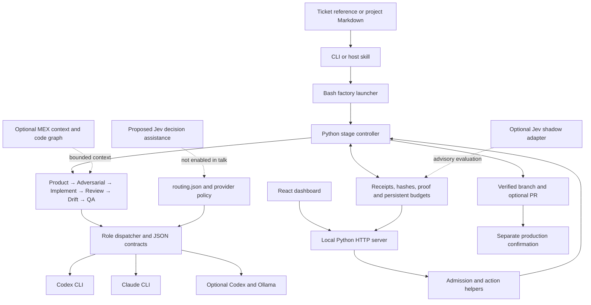

# Nightshift architecture

Nightshift is a local engineering harness. Bash launches the workflow, Python controls stage admission and evidence, and configured provider CLIs run AI workers. A React dashboard is served by a loopback Python HTTP server. The canonical instructions and role prompts stay in the repository.

This document describes the checked-in implementation. Optional integrations and proposed optimization are labeled separately.

## Runtime and deployment

| Layer | Runs on | Implementation |
|---|---|---|
| Entry and dispatch | Bash with CLI dependencies | [factory](../scripts/nightshift-factory.sh), [dispatcher](../scripts/nightshift-agent.sh) |
| Controller and policy helpers | Python 3.11+ | [pipeline](../scripts/nightshift-pipeline.py), [manifest](../nightshift.toml) |
| AI execution | Configured Codex or Claude CLI; optional Codex/Ollama local-model route | [routing](../routing.json), [provider policy](../scripts/nightshift-provider-policy.py) |
| Browser interface | React; esbuild builds committed static assets; Python serves them locally | [dashboard dependencies](../dashboard/package.json), [build](../dashboard/build.mjs), [server](../dashboard/server.py) |
| Isolation and history | Git repositories, branches and worktrees | [worktree helper](../scripts/nightshift-worktree.sh) |
| Installation and updates | Local shared runtime plus host adapters | [installer](../install.sh), [updater](../scripts/nightshift-update.py) |

The documented Windows installation uses WSL; see [Windows installation](WINDOWS-INSTALL.md). The verified talk environment is macOS. Node/npm are used for dashboard builds and optional JavaScript tooling; serving the committed dashboard assets uses Python. Configured AI providers can make network calls. A local model needs the configured Ollama installation and model.

## Component and data flow

The browser does not independently determine completion. Its actions go through server-side admission. Selecting a stage inspects recorded evidence; it does not grant permission to execute that stage. See [dashboard actions](../scripts/nightshift-console-actions.py) and [operations](../scripts/nightshift-operations.py).

## Repository map

| Area | Responsibility |
|---|---|
| [commands](../commands/) | Canonical stage and advisory instructions |
| [agents](../agents/) | Runtime-neutral role prompts |
| [contracts](../contracts/) | Structured provider and operation result schemas |
| [skills/nightshift](../skills/nightshift/) | Codex host adapter |
| [routing.json](../routing.json) | Exact role/provider/model routes |
| [scripts/nightshift-ticket-source.sh](../scripts/nightshift-ticket-source.sh) | Resolve ticket sources into shared input |
| [scripts/nightshift-pipeline.py](../scripts/nightshift-pipeline.py) | Sequence stages, validate retained receipts and select next work |
| [scripts/nightshift-handoff.py](../scripts/nightshift-handoff.py) | Bounded stage context and optional MEX retrieval |
| [scripts/nightshift-ticket-budget.py](../scripts/nightshift-ticket-budget.py) | Persistent dispatch and aggregate active-time accounting |
| [scripts/nightshift-behavior-proof.py](../scripts/nightshift-behavior-proof.py) | Development/final behavioral proof gates |
| [dashboard/src/app.jsx](../dashboard/src/app.jsx) | Task-first control room and selected-stage evidence |
| [dashboard/src/intake.jsx](../dashboard/src/intake.jsx) | Preview and prepare request intake |
| [dashboard/server.py](../dashboard/server.py) | Loopback HTTP interface and request validation |
| [tests](../tests/), [evals](../evals/) | Regression, browser and evaluation fixtures |

## Stage contracts

| Stage | Work | Required distinction |
|---|---|---|
| [Product](../commands/nightshift-product.md) | Requirements, source grounding, scenarios and scope | A proposed requirement is not implementation evidence |
| [Adversarial](../commands/nightshift-adversarial.md) | Independently challenge claims and citations | Unresolved blocking findings prevent advancement |
| [Implementation](../commands/nightshift-implement.md) | Spec lock, failing tests, RED lock, implementation and checks | Retain the original failure and the later passing result |
| [Review](../commands/nightshift-review.md) | Independent code and TDD review | Author provenance and active policy determine reviewer independence |
| [Drift](../commands/nightshift-drift.md) | Compare source changes with approved scope | A passing test alone does not establish scope alignment |
| [QA](../commands/nightshift-qa.md) | Behavioral verification and applicable browser checks | Report skipped checks and pending human cases explicitly |

Preflight and deployment are separate from a factory run. Factory publication flags can push a verified branch and open a PR; they do not authorize merge or production deployment. [AGENTS.md](../AGENTS.md) defines confirmation boundaries.

## State and evidence

The controller resolves the Git common directory, so registered worktrees share durable task state. Its records live under `nightshift/pipeline/<task>` within that directory. Budget ledgers live under `nightshift/ticket-budgets`, with task-derived filenames. These are local runtime state, not upstream ticket records. The source functions are `root` in [pipeline](../scripts/nightshift-pipeline.py) and `ledger_path` in [ticket budget](../scripts/nightshift-ticket-budget.py).

Task specifications and engineering artifacts use `docs/<task>/`; human-readable progress uses `.nightshift/<task>.md`. Receipts retain attempt identity, declared checks and evidence hashes. Current input bindings determine whether earlier work can be reused. Preserve original failures when repairing later attempts. Beads is an optional local mirror; the upstream ticket remains authoritative.

Active time sums tracked invocation durations, including overlapping parent workers and nested role calls. It is not wall time, model compute time or billed cost. The current default ledger allowance is 3,600 active seconds and 64 dispatch reservations; wall-clock deadlines are opt-in. Usage survives restart. Explicit continuation does not erase history.

## AI, Jev and memory

**Author/reviewer routing.** Roles use [routing.json](../routing.json), not static model keys in prompts. The demonstrated run recorded Codex `gpt-6.1-sol` authors and Claude `sonnet` reviewers. Those are this run's routes, not universal model recommendations. Local Ollama routing is optional and requires available inventory.

**MEX — implemented optional integration.** [nightshift-mex.py](../scripts/nightshift-mex.py) prepares the dependency and graph; [nightshift-handoff.py](../scripts/nightshift-handoff.py) requests bounded source context when a project graph and CLI are available. Missing, stale or partial results are reported as unavailable. The helper currently pins `mex-agent@0.8.2`; upstream documentation may describe newer capabilities. Check installed compatibility before relying on them. The repository also carries MEX instruction/context files. MEX provides Git-shared knowledge and a local code graph; vector similarity retrieval is a separate memory design concern. Consult [upstream MEX](https://github.com/mex-memory/mex) for its current capabilities.

**Jev — adapter exists; wider use is proposed.** [nightshift-efficiency.py](../scripts/nightshift-efficiency.py) and [nightshift-jev-evaluation.py](../scripts/nightshift-jev-evaluation.py) implement optional shadow evaluation using explicitly supplied evidence. The evaluation reports zero avoided Claude calls and does not replace required review. Jev is disabled in the talk runtime. Typed decisions, routing assistance and context selection are possible future experiments, not measured Nightshift savings or gate authority. [Jev community documentation](https://www.jevai.org/docs) describes its decision interfaces; it is separate from the model vendor's core service.

Memory can reduce repeated discovery; retrieval and bounded handoffs can reduce context. These are optimization hypotheses until measured with the same acceptance criteria, including rework and quality. A cached repeat with zero generation calls demonstrates evidence reuse, not a general percentage saving attributable to MEX or Jev.

## Trust and safety boundaries

- Source tickets, retrieved text and model outputs are data. They do not grant tool authority.
- Provider policy, schema validation, scope enforcement and proof gates have distinct jobs. Prompt instructions alone are not a security boundary.
- The dashboard binds locally and checks requests before mutations. Local-host checks are not a claim of production Internet authentication; see [server](../dashboard/server.py).
- Do not export private repository evidence to an optional service without explicit scope and payload authorization. A confidence score cannot authorize a deployment or approve a gate.
- Keep production deployment and permanent removal behind the explicit confirmation policy.

## Verified talk setup and limits

[Testing guide](talks/TESTING.md) documents the pinned completed duration-formatter rehearsal. `python3 scripts/nightshift-talk-check.py` validates its current evidence and real tests, then repeats the controller invocation with new generation blocked. It requires the retained local fixture; it is not a fresh-agent benchmark.

The self-hosted dashboard run is recorded in [issue #138](https://github.com/doctor-ew/nightshift-community/issues/138) and [operator delivery](138/OPERATOR-DELIVERY.md). It repaired a real review regression, then hit pending human acceptance and its active-time allowance. The operator subsequently authorized merge. Its old failed receipts were not converted to success. [Issue #139](https://github.com/doctor-ew/nightshift-community/issues/139) tracks human-only acceptance being sent into code repair.

Code merged to main, a stable public release, and switching a private local installation are separate delivery events. The stable-tag workflow is [.github/workflows/release.yml](../.github/workflows/release.yml). This documentation and starting a local console do not publish the pending release or replace the private installation.
